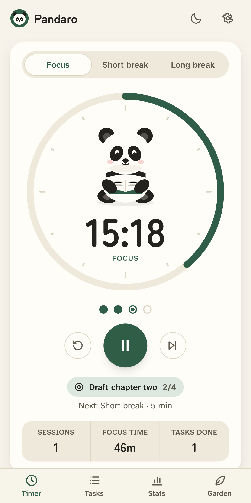
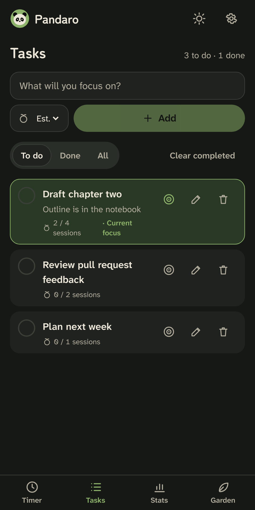
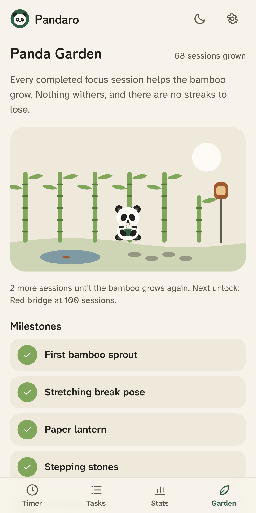

# Pandaro

**Stay focused. Stay panda.**

Pandaro is a calm, panda-themed Pomodoro timer with a task list, honest statistics and a small
bamboo garden that grows with every focus session. It works offline, needs no account, and keeps
your data on your device.

<p align="center">
  
  
  
</p>

## Features

- **Reliable timer.** Focus, short break and long break are configurable from 1 to 120 minutes.
  The countdown is computed from timestamps, so it stays accurate in background tabs, after
  sleep, refreshes and clock changes.
- **Pomodoro cycles.** Four focus sessions are followed by a long break; the cycle length is
  configurable. Pandaro can move to the next session automatically, and focus and breaks can
  each start on their own. Four session dots show where you are.
- **Panda companion.** Original vector panda with poses for idle, focus (reading), break (tea or
  stretching), paused and celebration. It reacts with a short encouragement when you pat it.
- **Tasks.** Quick add with Enter, notes, estimates, sessions counted per task, one current focus,
  complete and reopen, undo for deletes, drag or keyboard reordering, and filters.
- **Statistics.** Today's sessions, focus time and tasks, a 7-day chart, monthly total, a 12-week
  consistency map, and completed versus interrupted versus skipped sessions.
- **Panda Garden.** Bamboo grows from completed sessions. Milestones unlock decorations and a
  break pose. There are no streaks to lose and no purchases.
- **Gentle sound and notifications.** A three-note chime synthesised in the browser, with volume
  control. Optional notifications when a session ends.
- **Light and dark themes**, with no flash on start-up. Reduced motion, focus mode, keyboard
  shortcuts and screen-reader support are included.
- **Private by design.** No account, no analytics, no ads and no network requests. You can
  export and import a JSON backup, or delete everything.
- **Runs everywhere.** Installable PWA, self-hosted Docker image, and Android and iOS apps
  (Capacitor).

## Release status

| Target              | Status                                                                                                             |
| ------------------- | ------------------------------------------------------------------------------------------------------------------ |
| Web app and PWA     | Built, tested (unit, integration and end-to-end) and runs offline                                                  |
| Docker self-hosting | Image built and smoke-tested; end-to-end suite passes against the container                                        |
| Android             | Project builds an APK and AAB; lint is clean. **Not tested on a device or emulator.** Signing needs your keystore. |
| iOS                 | Project generated and statically checked. **No iOS binary built** (requires macOS and Xcode).                      |
| App stores          | Listing material prepared in [docs/store](docs/store). Not submitted.                                              |

The full list of checks and their evidence is in [VERIFICATION.md](VERIFICATION.md).

## Stack

React 19, TypeScript (strict), Vite 8, Tailwind CSS 4, Zustand, IndexedDB via `idb`, zod,
vite-plugin-pwa (Workbox), Capacitor 8, Vitest and Playwright. See
[ARCHITECTURE.md](ARCHITECTURE.md).

## Getting started

Requires Node.js 22 or later.

```bash
npm ci
npm run dev          # development server at http://localhost:5173
npm run build        # production build in dist/
npm run preview      # serve the production build at http://localhost:4173
```

### Checks

```bash
npm run format:check
npm run lint
npm run typecheck
npm test             # unit and integration tests (also runs in five time zones)
npm run test:coverage
npm run test:e2e     # Playwright; builds must exist (npm run build)
npm run verify       # everything above, in order
```

See [TESTING.md](TESTING.md) and [DEVELOPMENT.md](DEVELOPMENT.md).

## Self-hosting with Docker

```bash
docker compose up -d --build
# open http://localhost:8080
```

The container is a static nginx server running as a non-root user with a read-only filesystem
and a health check at `/healthz`. Service workers need HTTPS (or localhost), so put Pandaro
behind an HTTPS reverse proxy for anything other than local use. See
[DEPLOYMENT.md](DEPLOYMENT.md) for VPS, reverse-proxy and static-hosting instructions.

## Mobile apps

```bash
npm run cap:sync                 # build the web app and copy it into android/ and ios/
npm run android:build            # lint, debug APK and release AAB (needs the Android SDK)
npx cap open ios                 # on macOS with Xcode 26+
```

Release steps: [ANDROID_RELEASE.md](ANDROID_RELEASE.md) and [IOS_RELEASE.md](IOS_RELEASE.md).

## Keyboard shortcuts

| Key         | Action                      |
| ----------- | --------------------------- |
| Space       | Start or pause              |
| R           | Reset the session           |
| S           | Skip to the next session    |
| N           | Add a task                  |
| T           | Switch light or dark theme  |
| 1–4         | Timer, Tasks, Stats, Garden |
| Alt + ↑ / ↓ | Move the focused task       |
| ?           | Show shortcuts              |

## Privacy

Pandaro stores everything locally and sends nothing anywhere. See [PRIVACY.md](PRIVACY.md).

## License

[MIT](LICENSE). The panda artwork, icons and chime are original to this project and covered by
the same license. Fonts: Zen Maru Gothic and Atkinson Hyperlegible Next, both under the SIL Open
Font License 1.1, bundled via Fontsource.
